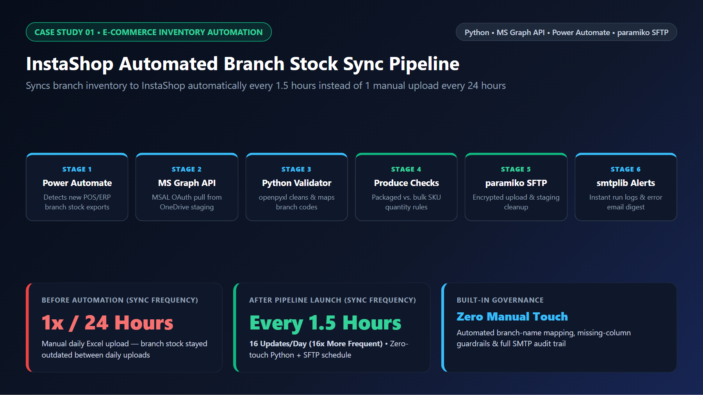
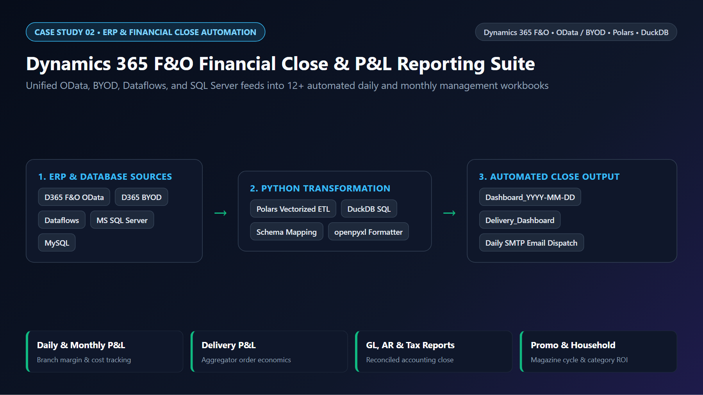
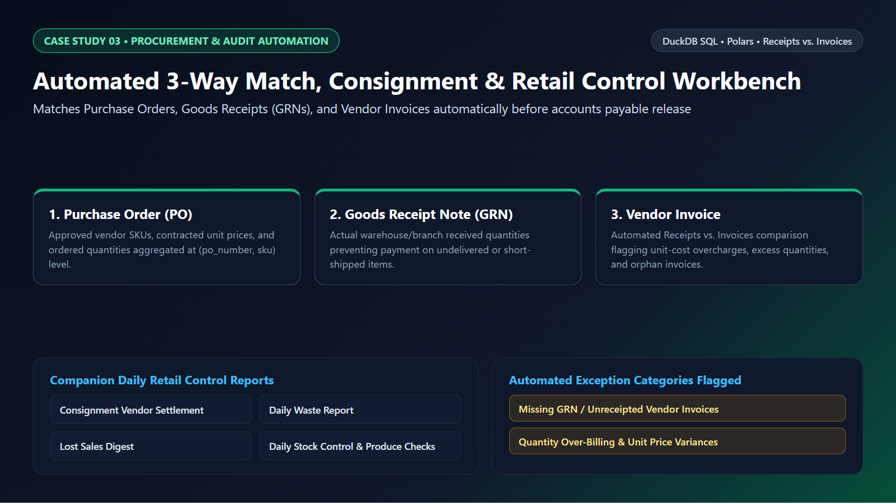
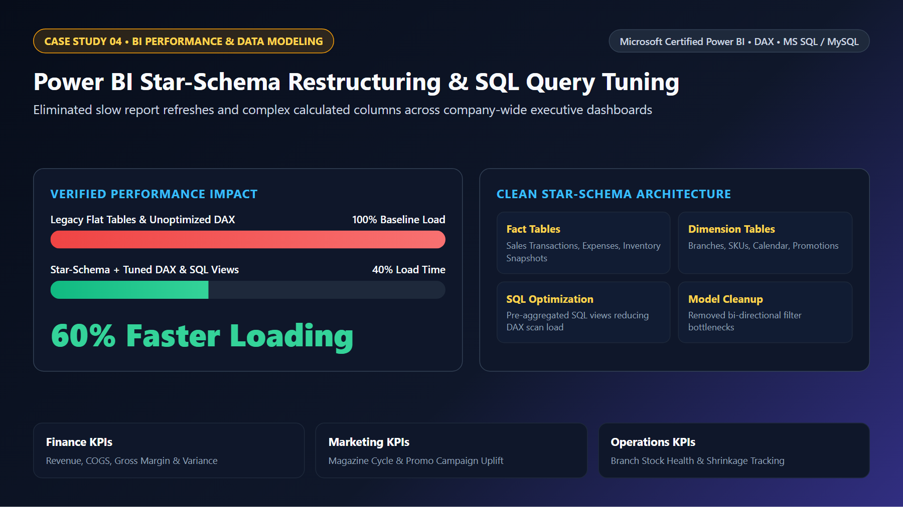
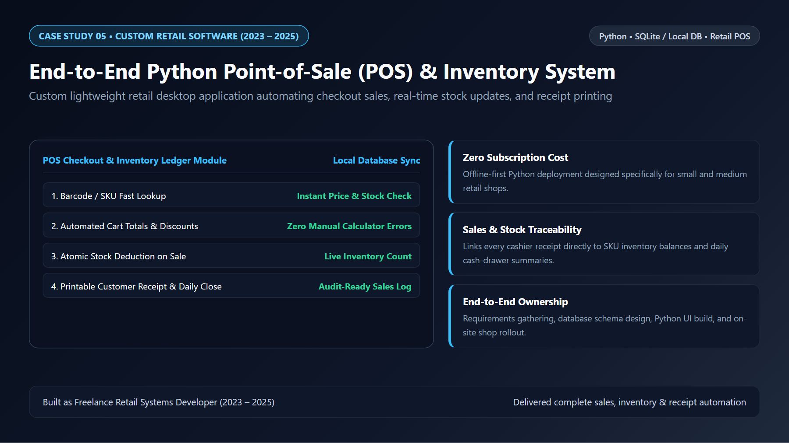

# Yahia Hosny Yahia — Financial Data Analyst & Automation Portfolio
**Role:** Financial Data Analyst & Python Data Automation Specialist | **Email:** Yahiahosny23@gmail.com | **Phone:** +20 115 676 1938 | **LinkedIn:** https://www.linkedin.com/in/yahia-hosny | **GitHub:** https://github.com/yahia-hosny | **Live Portfolio:** https://yahia-hosny.github.io/financial-data-analyst-portfolio/

I build automated financial reporting pipelines, ERP data integrations (Microsoft Dynamics 365 F&O & SQL), interactive Power BI dashboards, and procurement/inventory reconciliation systems that eliminate manual spreadsheet work.

---
## CS-01: InstaShop Automated Branch Stock Sync Pipeline (Every 1.5 Hours)

- **Tech Stack:** `Python, MS Graph API (MSAL), Power Automate, openpyxl, SFTP (paramiko), smtplib`
- **What It Is:** An unattended cloud-to-SFTP automation service that updates branch product availability and stock levels on InstaShop automatically every 1.5 hours.
- **Problem:** Staff had to manually format and upload Excel files only once every 24 hours, leaving branch stock outdated throughout the day.
- **Solution:** Built a Power Automate + MS Graph API (MSAL) -> Python (openpyxl) branch-code validator -> paramiko SFTP pipeline with OneDrive staging cleanup, packaged vs. bulk produce checks, and smtplib error/log email alerts.
- **Impact:** Automated InstaShop stock updates to run every 1.5 hours instead of once every 24 hours (16x more frequent inventory updates) with zero manual spreadsheet uploads.

## CS-02: Dynamics 365 F&O Financial Close & Delivery P&L Automation Suite

- **Tech Stack:** `D365 F&O (OData, BYOD, Dataflows), Python, Polars, DuckDB, MS SQL, MySQL, openpyxl`
- **What It Is:** A unified Python ETL and automated Excel reporting engine powering daily and monthly financial close across retail branches.
- **Problem:** Extracting and merging P&L, Delivery P&L, General Ledger (GL), Accounts Receivable (AR), and Tax reports from D365 F&O, MS SQL, and MySQL manually slowed down closing.
- **Solution:** Engineered repeatable Python (Polars & DuckDB) pipelines pulling directly from Dynamics 365 F&O (OData, BYOD, Dataflows) and SQL Server to generate standardized Dashboard_YYYY-MM-DD and Delivery_Dashboard workbooks automatically.
- **Impact:** Automated 12+ daily and monthly finance/operations workflows including P&L, GL, AR, Tax, Cost Control, Household Sales, and Promotion/Magazine cycle analytics.

## CS-03: Automated 3-Way Match Procurement & Retail Control Workbench

- **Tech Stack:** `DuckDB, Polars, SQL, 3-Way Match Reconciliation, Cost Control, Audit Automation`
- **What It Is:** An automated procurement auditing system matching Purchase Orders (PO), Goods Receipts (GRN), and Vendor Invoices before payment.
- **Problem:** Manual invoice verification risked paying for unreceipted goods, unit-price overcharges, and missed vendor consignment discrepancies.
- **Solution:** Built DuckDB & Polars pre-aggregation matching Receipts vs. Invoices at the (po_number, sku) level alongside automated Daily Waste Reports, Lost Sales Digests, Daily Stock Control, and Consignment Vendor Settlement audits.
- **Impact:** Replaced manual invoice checks with automated exception flagging across procurement, inventory waste, and vendor consignment settlements.

## CS-04: Power BI Star-Schema Restructuring & DAX / SQL Optimization

- **Tech Stack:** `Power BI, DAX, Star-Schema Data Modeling, MS SQL, MySQL, Power Query`
- **What It Is:** A full performance overhaul of company-wide executive Power BI dashboards tracking Finance, Marketing, and Operations KPIs.
- **Problem:** Flat table models, heavy calculated columns, and unindexed SQL queries caused slow dashboard refreshes and sluggish visual interactions.
- **Solution:** Redesigned relational star-schema data models, pushed heavy joins into tuned MS SQL / MySQL views, and refactored complex DAX measures.
- **Impact:** Accelerated Power BI and SQL report loading speeds by 60% for Finance, Marketing, and Operations leadership.

## CS-05: End-to-End Retail Python POS & Inventory Management System

- **Tech Stack:** `Python, Retail POS, Inventory Tracking, Receipt Automation, Local SQL`
- **What It Is:** A standalone Point-of-Sale (POS) and inventory tracking desktop application engineered for small and medium retail shops (2023–2025).
- **Problem:** Small retail shops lacked affordable software connecting checkout sales directly with live stock counts and daily cash-close reports.
- **Solution:** Designed and built a complete Python POS application covering barcode/SKU lookup, automated cart/tax calculation, real-time inventory deduction, and receipt printing.
- **Impact:** Delivered reliable sales ledger capture, automated stock updates, and daily close reporting without recurring SaaS licensing fees.
